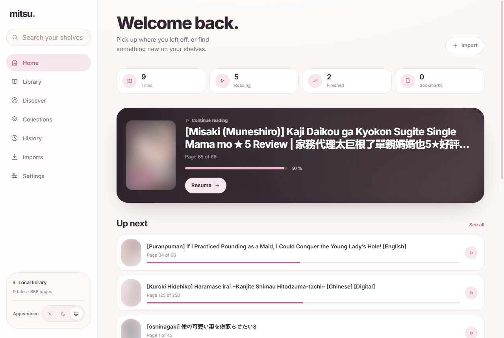
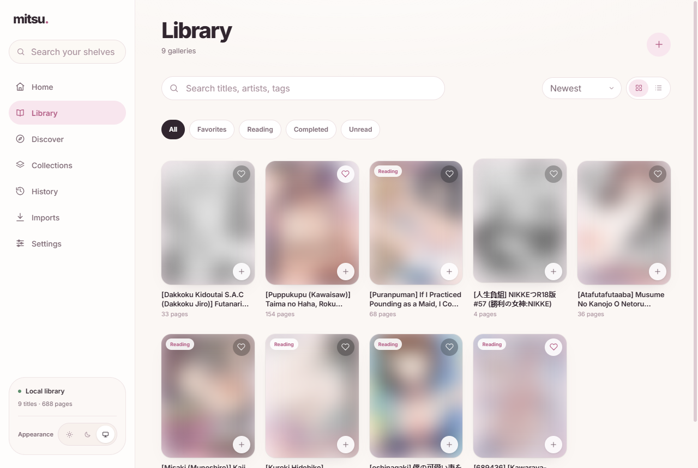
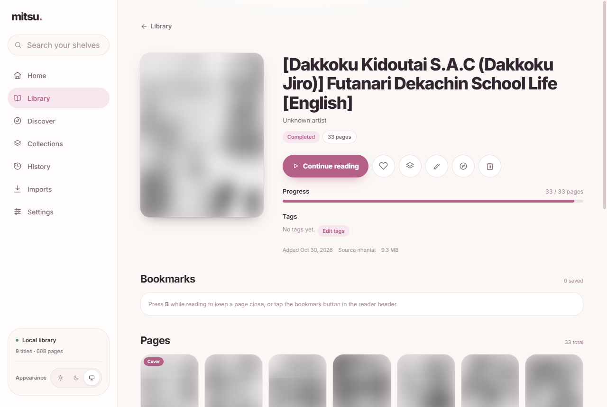
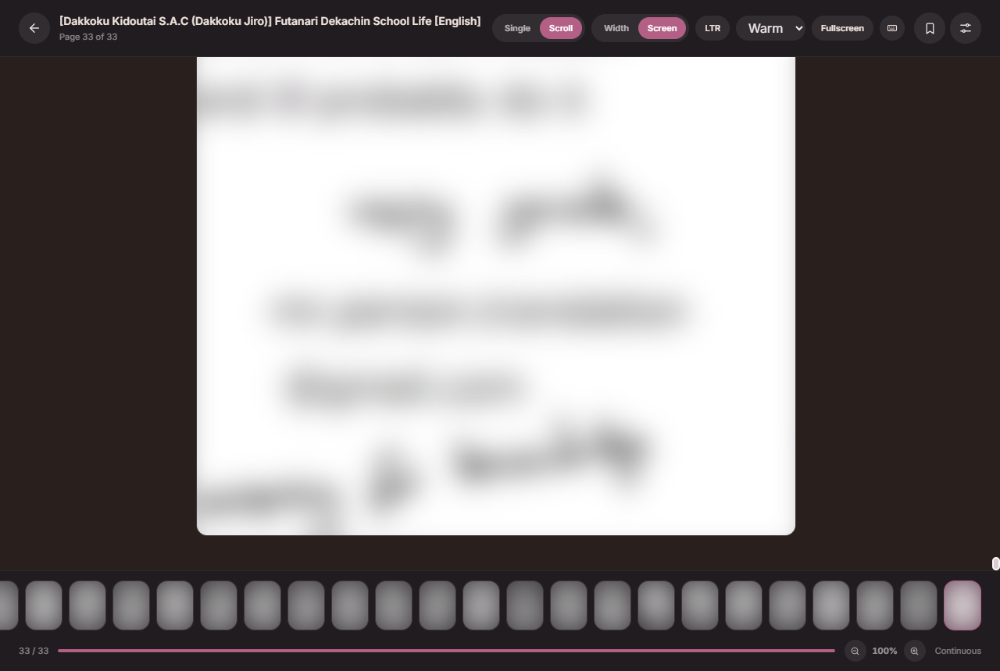
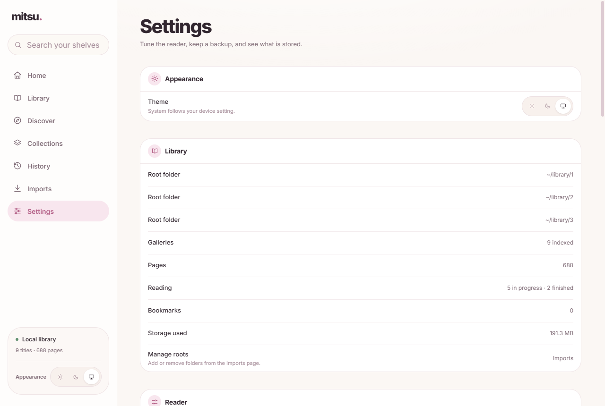

<p align="center">
  
</p>

<h1 align="center">mitsu.</h1>

<p align="center">
  <em>A quiet, local-first manga library and reader. Your files, your machine, your pace.</em>
</p>

<p align="center">
  
  
  
  
  
  
</p>

---

Mitsu is a **local-first** manga library and reader. It runs entirely on your own machine — no accounts, no cloud, no telemetry. Import CBZ, ZIP, image folders, or remote galleries, read them in a focused reader, and keep your collection organised in collections and reading lists. The interface is mobile-first, with an iOS-style navigation shell, and works just as well on a desktop browser.

## Download

Every tagged release ships three ways to install:

- **Source archive** — `mitsu-<version>.zip` from the [releases page](https://github.com/Chandu4143/mitsu/releases), with a `.sha256` checksum next to it.
- **Windows desktop app** — `Mitsu_<version>_x64-setup.exe` from the same releases page. Download it, run it, and launch Mitsu from the Start menu. The installer is self-contained: the API is bundled as a sidecar and WebView2 is installed if needed, so users do not need Python, Node.js, or pnpm. It installs per user and updates itself from GitHub Releases.
- **Container image** — `ghcr.io/chandu4143/mitsu:<version>` for `linux/amd64` and `linux/arm64` (also tagged `latest`).

### Run the archive

Extract the zip anywhere, then install once and start:

**Windows**

```powershell
powershell -ExecutionPolicy Bypass -File scripts/install.ps1 -Build
.venv\Scripts\python.exe run.py --prod
```

**macOS / Linux**

```bash
bash scripts/install.sh --build
.venv/bin/python run.py --prod
```

Open <http://127.0.0.1:3000>. The installer needs Python 3.11+, Node.js 20+, and pnpm (enabled through corepack when available).

### Run the container

```bash
docker run --rm -p 3000:3000 -v mitsu-data:/app/data ghcr.io/chandu4143/mitsu:latest
```

Open <http://127.0.0.1:3000>. The named volume holds your database, covers, and imported galleries, so updating the image never touches your collection.

To verify a download before running it:

```bash
sha256sum -c mitsu-1.2.0.zip.sha256
```

On Windows: `Get-FileHash mitsu-1.2.0.zip -Algorithm SHA256`.

### Build the desktop app

Mitsu ships a Tauri v2 shell (`src-tauri/`) that serves the static Next.js export from `out/` and starts the FastAPI backend as a bundled sidecar. Windows is the first target.

Requirements: Node.js 20+, pnpm, Python 3.11+, and Rust 1.77+ with a Windows target. Tauri officially supports the MSVC toolchain; this repository also builds with the MinGW (`x86_64-pc-windows-gnu`) toolchain, which is what the sidecar script names its output after.

```bash
pnpm install
python -m pip install -r backend/requirements-dev.txt pyinstaller

pnpm desktop:dev      # Next dev server + Rust shell + Python backend
pnpm desktop:build    # sidecar + release build + NSIS installer
```

`pnpm desktop:dev` starts Next.js on port 3000; the Rust shell then starts `uvicorn` on a free loopback port and injects that URL into the webview. `pnpm desktop:build` packages the backend with PyInstaller into `src-tauri/binaries/` and writes the installer to `src-tauri/target/release/bundle/nsis/`.

Bump the version in `package.json`, `src-tauri/tauri.conf.json`, and `src-tauri/Cargo.toml` together before tagging a release. The updater compares the installed version against the release it downloads.

Desktop data lives outside the repository, in the OS app data directory (`%APPDATA%\app.mitsu.desktop` on Windows). Set `MITSU_DATA_DIR` to override it, or `MITSU_BACKEND_BIN` to point at a different backend executable.

Auto-updates use the Tauri updater with signed artifacts. Producing updater artifacts needs the private key:

```powershell
$env:TAURI_SIGNING_PRIVATE_KEY = "$env:USERPROFILE\.tauri\mitsu.key"
$env:TAURI_SIGNING_PRIVATE_KEY_PASSWORD = ""
pnpm desktop:build
```

Releases are built by `.github/workflows/release.yml`, which reads `TAURI_SIGNING_PRIVATE_KEY` and `TAURI_SIGNING_PRIVATE_KEY_PASSWORD` from repository secrets. Keep the private key out of the repository; if it is lost, existing installs can no longer receive updates. The public key lives in `src-tauri/tauri.conf.json`.

## What's inside

- **Mobile-first shell** — fixed translucent top bar, five-item bottom tab bar, “More” bottom sheet, and a desktop rail from the same component tree.
- **Reader** — single-page, double-page spread, and continuous scroll; RTL and LTR; fit-to-width or fit-to-screen; zoom and pan (wheel, pinch, or keys); adjustable backgrounds; fullscreen; keyboard shortcuts; bookmarks with notes; and progress that is saved automatically.
- **Library** — instant search, filters, sorting, grid and list views, favorites, reading status, and a history view grouped by day.
- **Collections** — group galleries, reorder items, and jump back into reading.
- **Imports** — CBZ, ZIP, image folders, and library roots with live job progress, retry, and cancellation.
- **Discover** — paged nhentai search with sort and language filters, favorite counts, one-click import, and local metadata sources.
- **Settings** — grouped preferences, appearance (light/dark/system), cover rebuilds, duplicate detection, and portable backup and restore.
- **Installable** — a web app manifest and service worker cache the shell and the pages you have already read. Dark mode follows your device or your choice.
- **Desktop app** — a Tauri v2 shell for Windows with a per-user NSIS installer and signed auto-updates. It runs the same UI, bundles the API, and keeps your library in the OS app data directory.
- **Local-first** — no accounts, no cloud, no telemetry; the server binds to `127.0.0.1` by default.

## Screenshots

### Mobile

<p align="center">
  
  
  
</p>
<p align="center">
  
  
  
</p>

### Desktop

<p align="center">
  
  
</p>
<p align="center">
  
  
</p>
<p align="center">
  
  
</p>

### Desktop app

Captured from the packaged Windows build rather than a browser.

<p align="center">
  
  
</p>
<p align="center">
  
  
</p>
<p align="center">
  
</p>

> Cover art is blurred in these screenshots because the library contains adult content. Personal filesystem paths are redacted to `~/library`.

## Quick start

### Requirements

- Python 3.11 or newer
- Node.js 20 or newer
- pnpm (the installer enables it through corepack when needed)
- Google Chrome (only for regenerating screenshots)

### Install

One command sets up a local virtual environment and the frontend packages.

**Windows**

```powershell
powershell -ExecutionPolicy Bypass -File scripts/install.ps1
```

**macOS / Linux**

```bash
bash scripts/install.sh
```

Add `--build` (or `-Build` on Windows) to create the production frontend build as
well.

<details>
<summary>Manual install</summary>

```bash
git clone https://github.com/Chandu4143/mitsu.git
cd mitsu
python -m venv .venv
# Windows
.venv\Scripts\activate
# macOS / Linux
source .venv/bin/activate
pip install -r backend/requirements.txt
pnpm install
```

</details>

### Run

```bash
python run.py
```

`run.py` starts both services together, waits for the frontend, and opens your
browser. Press `Ctrl+C` to stop everything.

Then:

- Frontend: <http://127.0.0.1:3000>
- Backend API: <http://127.0.0.1:8000>

For the production build:

```bash
pnpm build
python run.py --prod
```

Use `--no-browser` if you would rather open the app yourself.

### Docker

```bash
docker compose up --build
```

Open <http://127.0.0.1:3000>. Compose bind-mounts `./data` into the container,
so the database, covers, and managed library survive rebuilds. The container is
self-contained; only port `3000` is published.

## Importing a library

Mitsu does not move your original files. Imports are copied into the managed library directory, so the source files stay where they are.

1. Open **Imports** from the sidebar or the “More” sheet.
2. Paste an absolute path to a CBZ, ZIP, image, or folder, or register a library root.
3. Watch the job progress. Failed or cancelled jobs can be retried or dismissed.

Supported inputs:

- `.cbz` and `.zip` archives
- Folders of images
- Library roots for repeated imports

## Configuration

Copy `.env.example` to `backend/.env` (or export the values in your shell). Every value has a sensible default.

| Variable | Default | Purpose |
| --- | --- | --- |
| `MITSU_DATA_DIR` | `<repo>/data` | SQLite database, thumbnails, and cache |
| `MITSU_LIBRARY_ROOT` | `<data>/library` | Where imported galleries are stored |
| `MITSU_HOST` | `127.0.0.1` | Backend bind address |
| `MITSU_PORT` | `8000` | Backend port |
| `MITSU_FRONTEND_HOST` | `127.0.0.1` | Frontend bind address (`0.0.0.0` to expose it on your network) |
| `MITSU_FRONTEND_ORIGIN` | `http://localhost:3000` | Allowed CORS origin for the frontend |

The frontend talks to the backend through a Next.js rewrite, so the browser only needs to reach port `3000`.

## Architecture

```text
┌──────────────────────┐      HTTP / JSON      ┌──────────────────────┐
│  Next.js 16          │ ────────────────────▶ │  FastAPI             │
│  React 19            │ ◀──────────────────── │  Python              │
│  Tailwind CSS v4     │   /api/v1 rewrite     │  SQLAlchemy + SQLite │
└──────────────────────┘                       └──────────────────────┘
```

- `app/` — Next.js App Router pages and layouts
- `components/` — shared UI, icons, and the navigation shell
- `lib/api.ts` — typed client for the backend
- `backend/app/` — FastAPI routes, services, and database models
- `data/` — local database, library, thumbnails, and cache (gitignored)

## Development

```bash
pnpm dev          # Next.js dev server
pnpm lint         # ESLint
pnpm typecheck    # TypeScript without emitting
pnpm build        # Production build
pnpm package      # dist/mitsu-<version>.zip + SHA-256 checksum
pnpm screenshots  # Regenerate README screenshots
pnpm screenshots:desktop  # Regenerate README screenshots from the running desktop app
```

Run the backend separately if you prefer:

```bash
cd backend
python -m uvicorn app.main:app --host 127.0.0.1 --port 8000
```

Screenshot capture expects Chrome at `C:/Program Files/Google/Chrome/Application/chrome.exe` and a running app. Override either with `CHROME_PATH` or `MITSU_SCREENSHOT_URL`. Screenshots are written to `public/screenshots/`.

For the desktop-app screenshots, run the built shell with WebView2 remote debugging enabled and then run the capture script:

```powershell
$env:WEBVIEW2_ADDITIONAL_BROWSER_ARGUMENTS = "--remote-debugging-port=9333"
.\src-tauri\target\debug\mitsu.exe
pnpm screenshots:desktop   # in a second terminal
```

Set `MITSU_CDP_URL` if you use a different debugging port.

## Releasing

1. Set the same version in `package.json`, `backend/app/main.py`, `backend/app/services/maintenance.py`, `src-tauri/tauri.conf.json`, and `src-tauri/Cargo.toml`, and add a `CHANGELOG.md` entry.
2. Run `pnpm package` and check `dist/mitsu-<version>.zip` plus its `.sha256`.
3. Tag and push:

   ```bash
   git tag v1.2.0
   git push origin v1.2.0
   ```

The release workflow verifies that the tag matches `package.json`, pushes a
multi-arch image to `ghcr.io/chandu4143/mitsu`, builds the Windows installer and
updater manifest, and attaches the archive, checksum, and installer to the
GitHub release.

## Data and backups

Everything lives under `data/`:

- `data/database/mitsu.db` — gallery metadata, collections, bookmarks, history, jobs, and settings
- `data/library/` — imported gallery copies and generated covers
- `data/thumbnails/` — generated thumbnails (safe to delete; regenerated on demand)
- `data/cache/` — transient cache

**Settings → Backup & restore** exports a portable zip:

- `manifest.json` — app version, timestamp, and gallery count
- `database/mitsu.db` — a consistent SQLite snapshot taken with SQLite's backup API
- `library/…` — your managed files, when “full backup” is chosen
- `stats.json` — a human-readable library summary

Restoring validates the zip and the database integrity first, then writes a
timestamped safety copy of the current database (and library, when included)
before replacing anything. You can also copy `data/` yourself at any time;
thumbnails and cache are disposable.

## Troubleshooting

- **The frontend loads but no galleries appear.** Make sure the backend is running on port `8000` and that you have imported at least one gallery.
- **Imports fail.** Check that the path is absolute and that the files are readable. Library roots must point at existing directories.
- **Port already in use.** Stop the other process, or change `MITSU_PORT` and the frontend origin accordingly.
- **Screenshot capture fails.** Ensure the app is running, Chrome is installed, and `CHROME_PATH` points at it if it is not in the default location.

## License

MIT.
