<<<<<<< HEAD
<p align="center">
  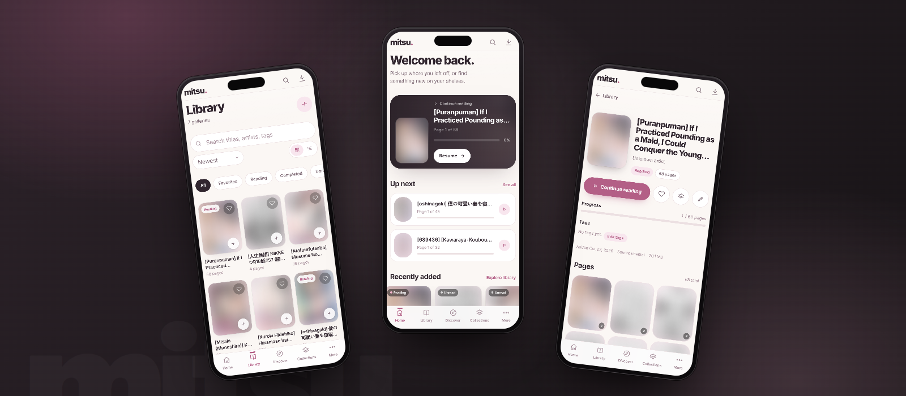
</p>
=======

>>>>>>> 54eb9bedf4be6d9e468ad687693b045d13d441ab

<h1 align="center">mitsu.</h1>

<p align="center">
  <em>A quiet, local-first manga library and reader. Your files, your machine, your pace.</em>
</p>

<p align="center">
  
  
  
  
  
  
</p>

---

Mitsu is a **local-first** manga library and reader. It runs entirely on your own machine — no accounts, no cloud, no telemetry. Import CBZ, ZIP, image folders, or remote galleries, read them in a focused reader, and keep your collection organised in collections and reading lists. The interface is mobile-first, with an iOS-style navigation shell, and works just as well on a desktop browser.

## What's inside

- **Mobile-first shell** — fixed translucent top bar, five-item bottom tab bar, “More” bottom sheet, and a desktop rail from the same component tree.
- **Reader** — single-page and continuous scroll, RTL and LTR, fit-to-width or fit-to-screen, adjustable backgrounds, fullscreen, keyboard navigation, and progress that is saved automatically.
- **Library** — search, filters, sorting, grid and list views, favorites, and reading status.
- **Collections** — group galleries, reorder items, and jump back into reading.
- **Imports** — CBZ, ZIP, image folders, and library roots with live job progress, retry, and cancellation.
- **Discover** — local metadata sources and optional remote search.
- **Settings** — grouped preferences, library roots, and a live overview of your collection.

## Screenshots

### Mobile

<p align="center">
  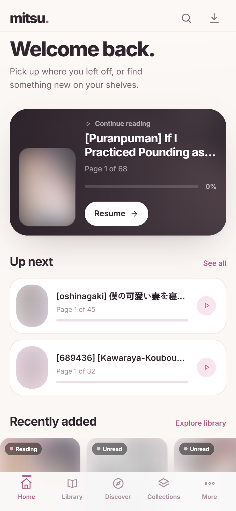
  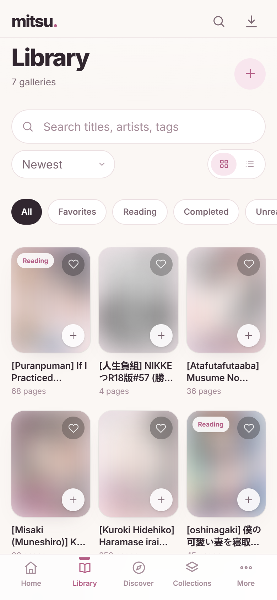
  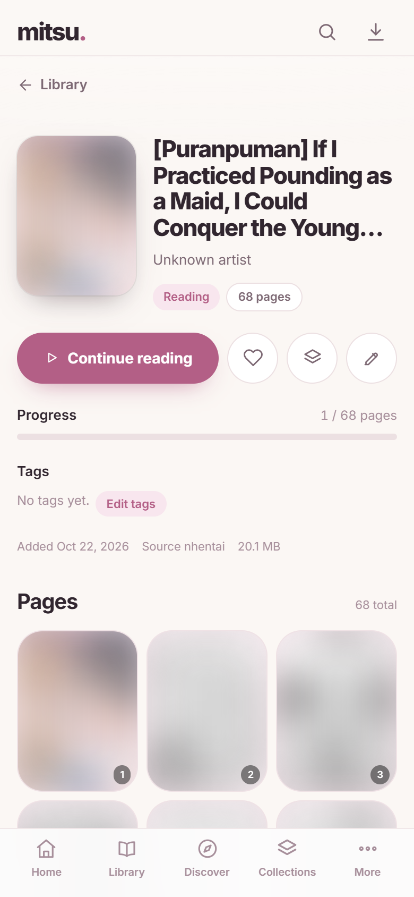
</p>
<p align="center">
  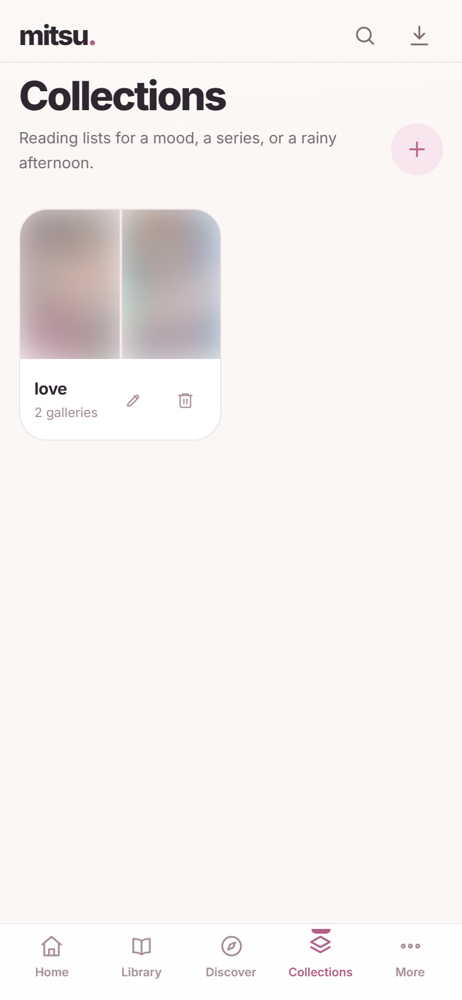
  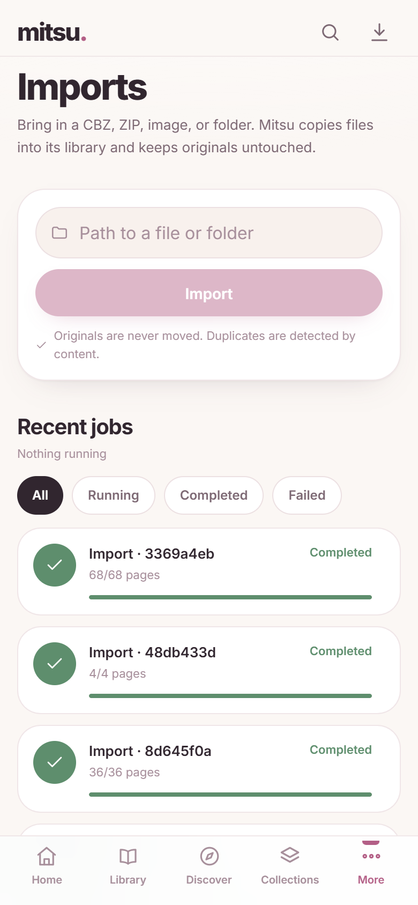
  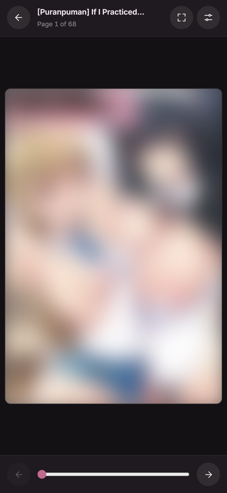
</p>

### Desktop

<p align="center">
  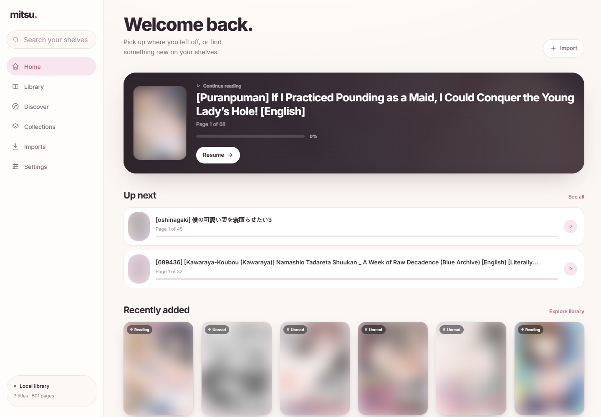
  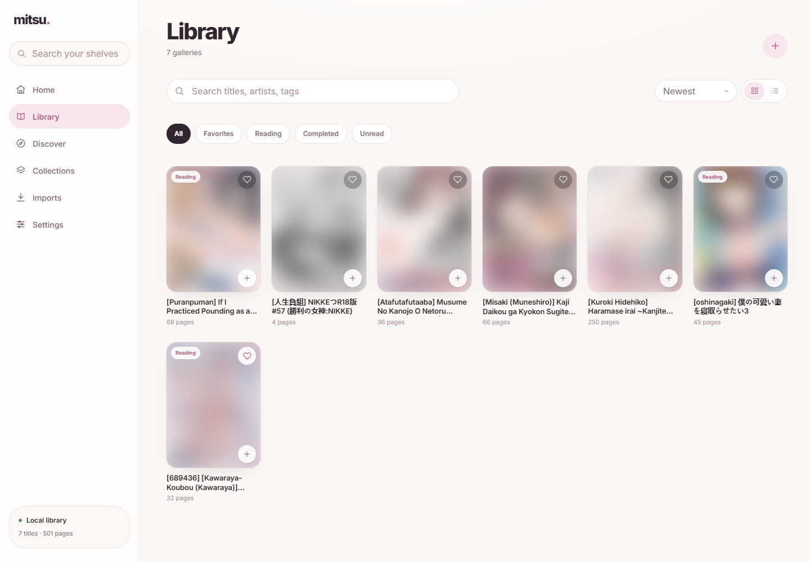
</p>
<p align="center">
  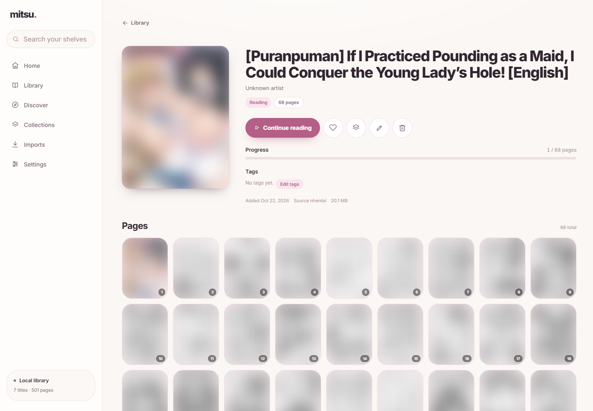
  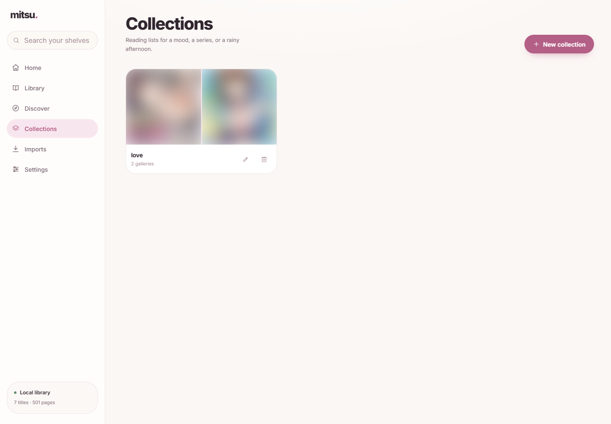
</p>
<p align="center">
  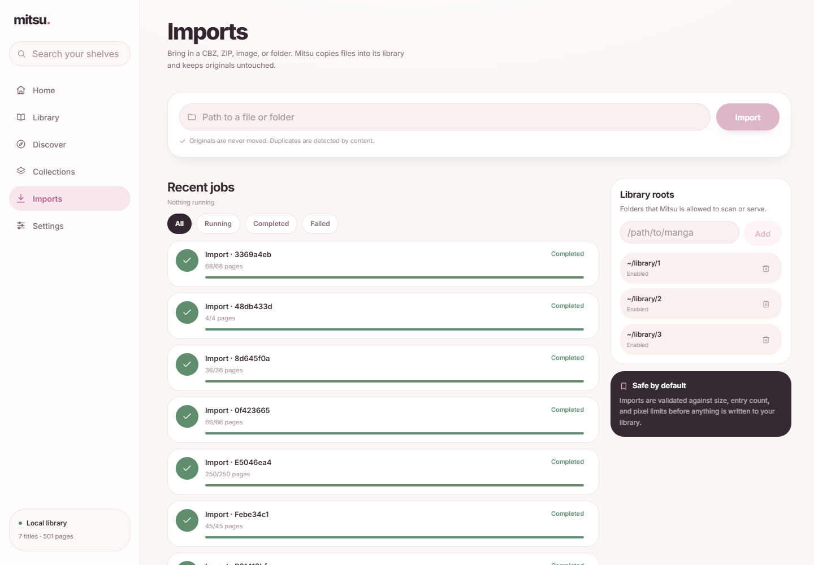
  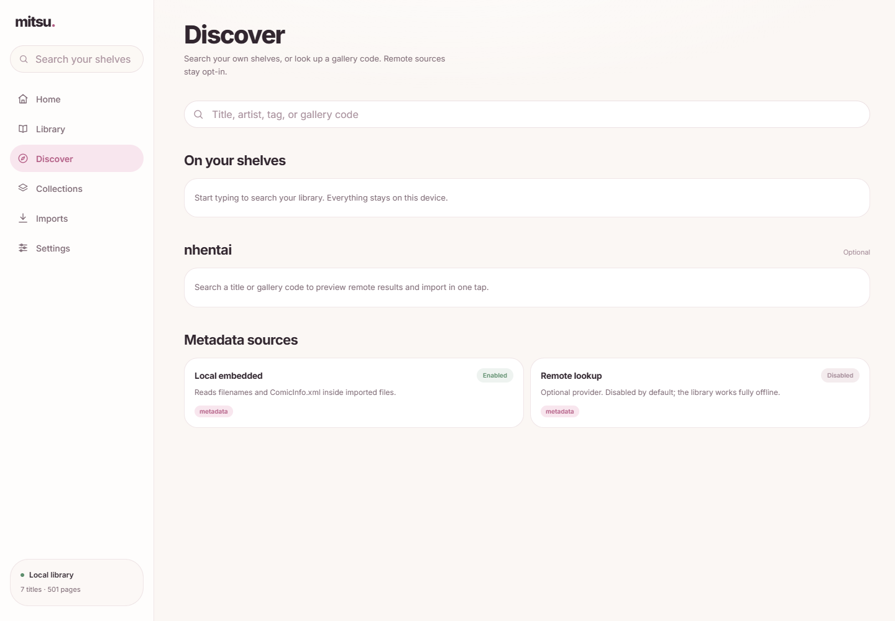
</p>

> Cover art is blurred in these screenshots because the library contains adult content. Personal filesystem paths are redacted to `~/library`.

## Quick start

### Requirements

- Python 3.11 or newer
- Node.js 20 or newer
- pnpm
- Google Chrome (only for regenerating screenshots)

### Install

```bash
git clone https://github.com/your-user/mitsu.git
cd mitsu
python -m venv .venv
# Windows
.venv\Scripts\activate
# macOS / Linux
source .venv/bin/activate
pip install -r backend/requirements.txt
pnpm install
```

### Run

```bash
python run.py
```

Then open:

- Frontend: <http://127.0.0.1:3000>
- Backend API: <http://127.0.0.1:8000>

`run.py` starts both services and shuts them down together. Press `Ctrl+C` to stop.

## Importing a library

Mitsu does not move your original files. Imports are copied into the managed library directory, so the source files stay where they are.

1. Open **Imports** from the sidebar or the “More” sheet.
2. Paste an absolute path to a CBZ, ZIP, image, or folder, or register a library root.
3. Watch the job progress. Failed or cancelled jobs can be retried or dismissed.

Supported inputs:

- `.cbz` and `.zip` archives
- Folders of images
- Library roots for repeated imports

## Configuration

Copy `.env.example` to `backend/.env` (or export the values in your shell). Every value has a sensible default.

| Variable | Default | Purpose |
| --- | --- | --- |
| `MITSU_DATA_DIR` | `<repo>/data` | SQLite database, thumbnails, and cache |
| `MITSU_LIBRARY_ROOT` | `<data>/library` | Where imported galleries are stored |
| `MITSU_HOST` | `127.0.0.1` | Backend bind address |
| `MITSU_PORT` | `8000` | Backend port |
| `MITSU_FRONTEND_ORIGIN` | `http://localhost:3000` | Allowed CORS origin for the frontend |

The frontend talks to the backend through a Next.js rewrite, so the browser only needs to reach port `3000`.

## Architecture

```text
┌──────────────────────┐      HTTP / JSON      ┌──────────────────────┐
│  Next.js 16          │ ────────────────────▶ │  FastAPI             │
│  React 19            │ ◀──────────────────── │  Python              │
│  Tailwind CSS v4     │   /api/v1 rewrite     │  SQLAlchemy + SQLite │
└──────────────────────┘                       └──────────────────────┘
```

- `app/` — Next.js App Router pages and layouts
- `components/` — shared UI, icons, and the navigation shell
- `lib/api.ts` — typed client for the backend
- `backend/app/` — FastAPI routes, services, and database models
- `data/` — local database, library, thumbnails, and cache (gitignored)

## Development

```bash
pnpm dev          # Next.js dev server
pnpm lint         # ESLint
pnpm typecheck    # TypeScript without emitting
pnpm build        # Production build
pnpm screenshots  # Regenerate README screenshots
```

Run the backend separately if you prefer:

```bash
cd backend
python -m uvicorn app.main:app --host 127.0.0.1 --port 8000
```

Screenshot capture expects Chrome at `C:/Program Files/Google/Chrome/Application/chrome.exe` and a running app. Override either with `CHROME_PATH` or `MITSU_SCREENSHOT_URL`. Screenshots are written to `public/screenshots/`.

## Data and backups

Everything lives under `data/`:

- `data/database/mitsu.db` — gallery metadata, collections, jobs, and settings
- `data/library/` — imported gallery copies
- `data/thumbnails/` — generated covers (safe to delete; regenerated on demand)
- `data/cache/` — transient cache

To back up your collection, copy `data/database/mitsu.db` and `data/library/`. Thumbnails and cache can be regenerated.

## Troubleshooting

- **The frontend loads but no galleries appear.** Make sure the backend is running on port `8000` and that you have imported at least one gallery.
- **Imports fail.** Check that the path is absolute and that the files are readable. Library roots must point at existing directories.
- **Port already in use.** Stop the other process, or change `MITSU_PORT` and the frontend origin accordingly.
- **Screenshot capture fails.** Ensure the app is running, Chrome is installed, and `CHROME_PATH` points at it if it is not in the default location.

## License

MIT.
