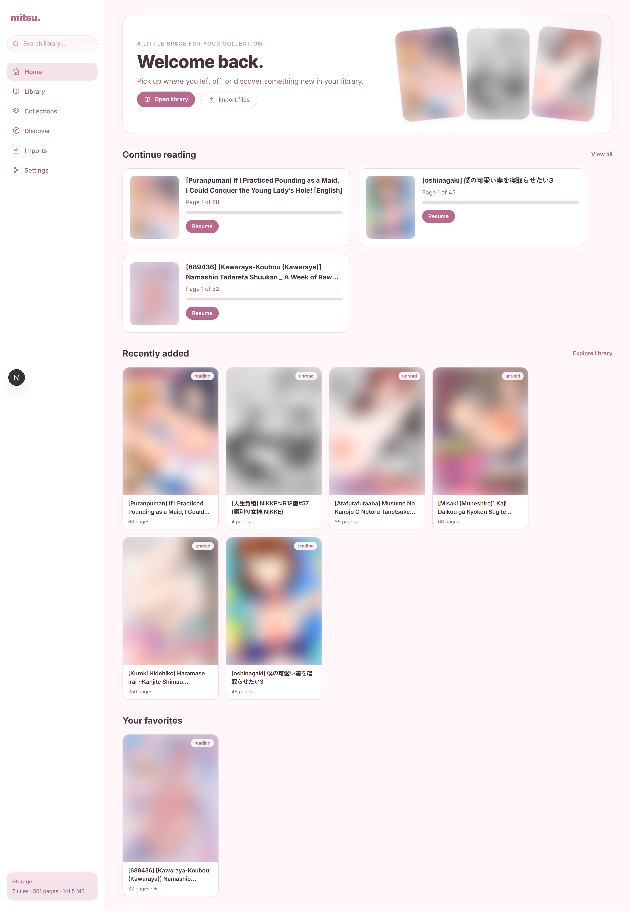
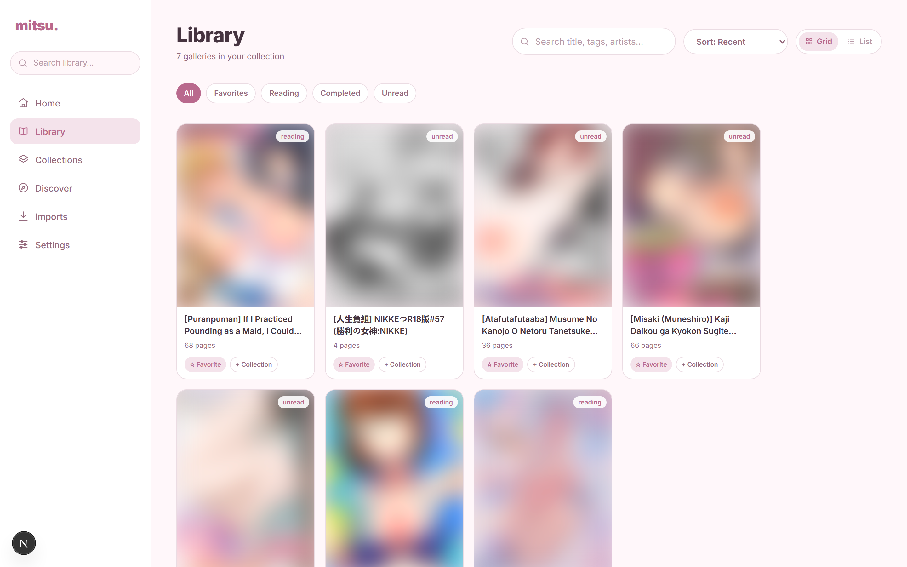
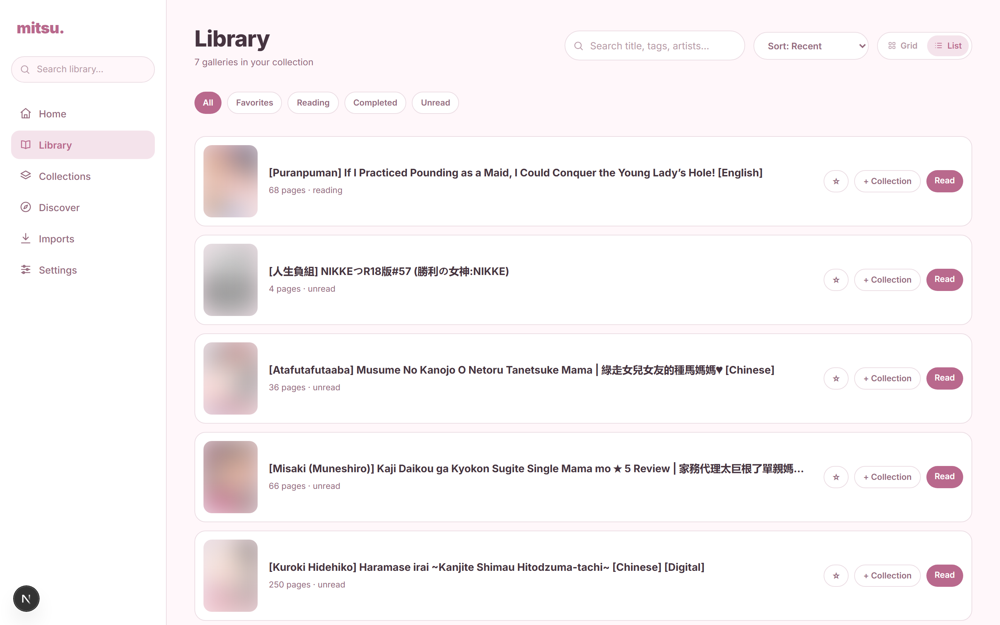
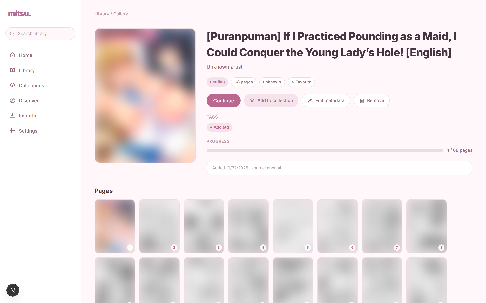
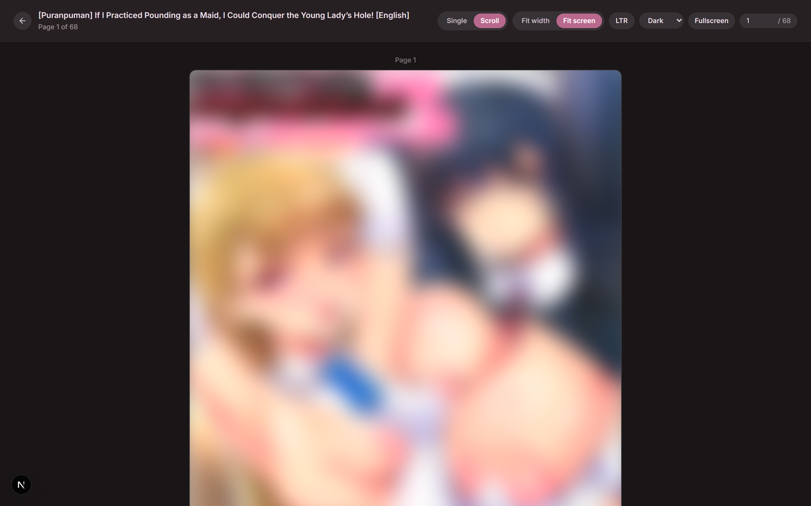
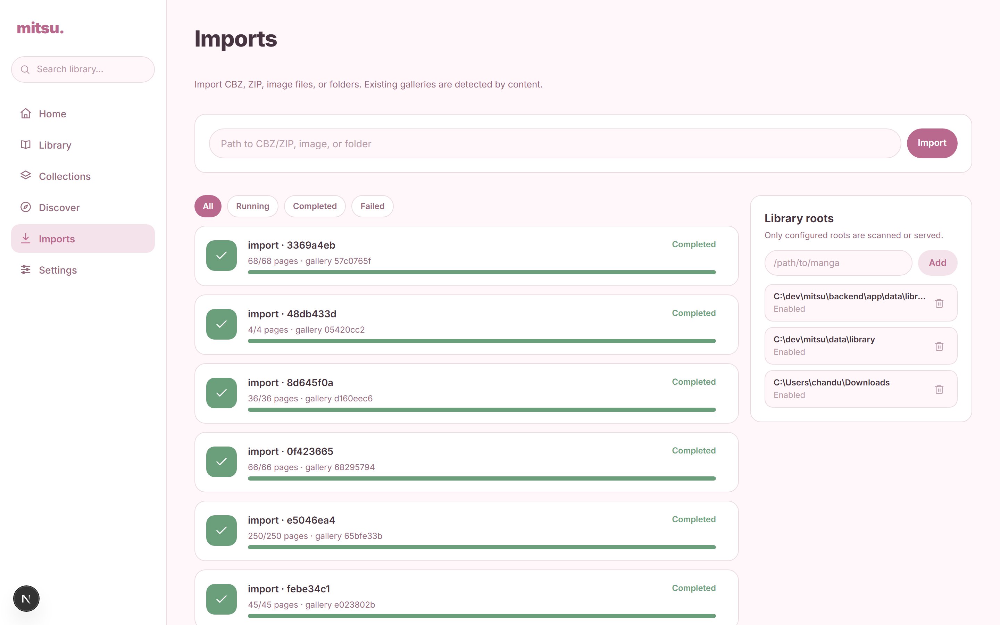

<p align="center">
  
</p>

<h1 align="center">mitsu.</h1>

<p align="center">
  <em>your little reading corner — a local-first manga library &amp; reader</em>
</p>

<p align="center">
  
  
  
  
  
</p>

---

Mitsu is a **local-first** manga library and reader inspired by [Peach](https://github.com/peachs). React + Next.js frontend, Python + FastAPI backend, SQLite storage. Everything runs on your machine — **no accounts, no cloud, no telemetry**.

## ✨ Screenshots

<details open>
<summary><strong>Home — Dashboard</strong></summary>
<br/>

</details>

<details>
<summary><strong>Library — Grid view</strong></summary>
<br/>

</details>

<details>
<summary><strong>Library — List view</strong></summary>
<br/>

</details>

<details>
<summary><strong>Gallery — Detail page</strong></summary>
<br/>

</details>

<details>
<summary><strong>Reader</strong></summary>
<br/>

</details>

<details>
<summary><strong>Imports</strong></summary>
<br/>

</details>

## 🎯 Features

| | |
| --- | --- |
| 📚 **Library** | Browse your collection as a cover grid or list. Search by title, tags, artists. Filter by status. Sort by date, title, or page count. |
| 📖 **Reader** | Single-page & continuous-scroll modes, keyboard navigation, fit-to-width/screen, fullscreen, dark background, LTR/RTL reading direction. Progress saves automatically. |
| 📦 **Import** | Drop in a CBZ/ZIP archive, a folder of images, or a single image file. Background import with live progress. Duplicate detection by content hash. ComicInfo.xml parsing. |
| ⭐ **Favorites** | Star galleries from anywhere — cards, detail pages, or the library. |
| 📁 **Collections** | Organize galleries into manually curated collections. |
| 🔍 **Discover** | *(Optional)* Search nhentai.net and import galleries directly. Requires `cloudscraper` — everything works without it. |
| 🔒 **Private** | Runs on `localhost`. No accounts, no tracking. Your files never leave your machine. |

## 🚀 Getting started

### Requirements

- **Node.js 18+** and [pnpm](https://pnpm.io/) (`npm install -g pnpm`)
- **Python 3.12+**

### 1. Install dependencies

```bash
# Frontend
pnpm install

# Backend
python -m pip install -r backend/requirements.txt
```

> **Windows note:** if `python` isn't found, try `py -m pip install -r backend/requirements.txt` (and make sure Python is on your PATH).

### 2. Start everything

```bash
python run.py
```

This starts the backend API on `http://127.0.0.1:8000` and the frontend on `http://localhost:3000`. Press `Ctrl+C` to stop both.

You can also run them separately:

```bash
# Backend
cd backend
python -m uvicorn app.main:app --host 127.0.0.1 --port 8000

# Frontend (in another terminal, from repo root)
pnpm dev
```

Then open **http://localhost:3000**.

## 📦 Importing manga

1. Go to **Imports** (`/imports`)
2. Paste the **absolute path** to a `.cbz`/`.zip` archive, a folder of images, or a single image
3. Click **Import** — progress is tracked in real time

**Good to know:**
- Original files are **never moved or deleted** — Mitsu copies them into its own library
- Duplicates are detected by content hash (safe to re-import)
- `ComicInfo.xml` metadata (title, writer, language, genres) is parsed automatically

## 🔍 Discover / nhentai *(optional)*

The Discover page lets you search nhentai.net and import galleries. It's **entirely opt-in**:

- Powered by `cloudscraper` (listed in `backend/requirements.txt`)
- Skip or remove `cloudscraper` to disable it — everything else works normally
- When disabled, the API returns a clear `503` and the UI shows "provider unavailable"

## ⚙️ Configuration

No configuration required. All options are environment variables — see [`.env.example`](.env.example) for the full list.

| Variable | Default | Purpose |
| --- | --- | --- |
| `MITSU_DATA_DIR` | `<repo>/data` | SQLite DB, thumbnails, and cache |
| `MITSU_LIBRARY_ROOT` | `<data>/library` | Where imported galleries are stored |
| `MITSU_HOST` / `MITSU_PORT` | `127.0.0.1` / `8000` | Backend bind address |
| `MITSU_FRONTEND_ORIGIN` | `http://localhost:3000` | Allowed CORS origin |
| `MITSU_MAX_ARCHIVE_BYTES` | `4 GiB` | Max single archive size |
| `MITSU_MAX_EXTRACTED_BYTES` | `8 GiB` | Max size once extracted |
| `MITSU_MAX_ARCHIVE_ENTRIES` | `20 000` | Max files per archive |
| `MITSU_MAX_IMAGE_PIXELS` | `80 MP` | Decompression-bomb guard |

Set values in your shell or in `backend/.env` (gitignored — copy from `.env.example`).

## 💾 Data & backup

Everything lives under `data/` — a single folder, gitignored, easy to back up:

```
data/
  database/mitsu.db   ← the SQLite database
  library/            ← imported gallery files
  thumbnails/         ← derived, safe to delete (regenerates lazily)
  cache/              ← transient
```

**Backup:** stop the app, copy `data/`. To keep it minimal, just back up `data/database/mitsu.db`.

## 🛠 Development

| | |
| --- | --- |
| **Backend** | `backend/app/` — FastAPI + SQLAlchemy. Restart after edits. |
| **Frontend** | `app/` — Next.js App Router with Tailwind CSS. Hot reload via `pnpm dev`. |

## 🐛 Troubleshooting

| Problem | Fix |
| --- | --- |
| `ModuleNotFoundError: No module named 'fastapi'` | Run `python -m pip install -r backend/requirements.txt` |
| Port 8000 or 3000 already in use | Stop the other process, or set `MITSU_PORT` / `pnpm dev -- -p 3001` |
| Import fails with "Path not found" | Use an absolute path (`C:\Users\you\manga`, not `~\manga`) |
| Import fails with "Archive exceeds size limit" | Raise `MITSU_MAX_ARCHIVE_BYTES` in `.env` |
| Page shows blank / image fails | Delete `data/cache/` and `data/thumbnails/`, restart |
| Discover shows "provider unavailable" | `cloudscraper` isn't installed |

## 📄 License

MIT — see [LICENSE](LICENSE).
